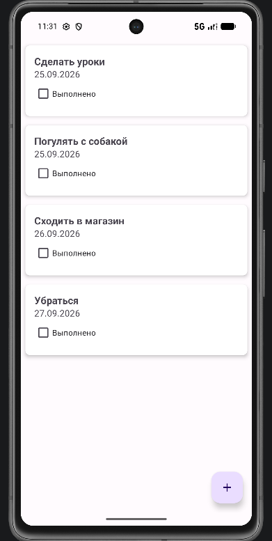
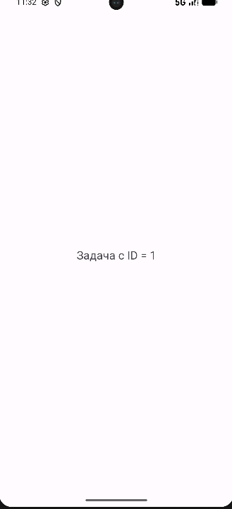

# TaskCalendar

Приложение «Календарь задач» для Android.

## Функционал (в разработке)
- Список задач
- Добавление и редактирование
- Календарное представление
- Напоминания

## Технологии
- Kotlin
- Room
- MVVM
- Coroutines / Flow

## Сборка
Открыть проект в Android Studio, нажать Run.

## Отчеты и скриншоты (Этапы 1-4)

- [Отчет по этапам 1-3](reports/reports.md)
- [Схема экранов](reports/Shema.jpg)
- [Схема архитектуры](reports/architecture.png)
- **Скриншоты работы приложения:**
    - Главный экран (список из базы данных): 
    - Экран деталей задачи: 
    - Скриншот повернутого экрана [Повернутый экран](reports/screen_mvvm_landscape.png)
